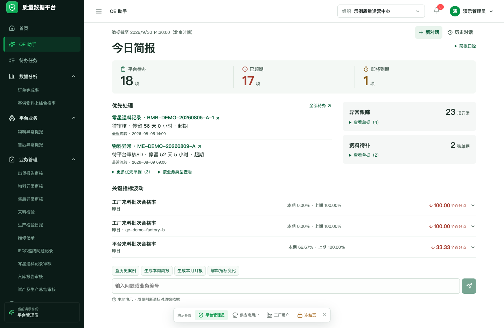
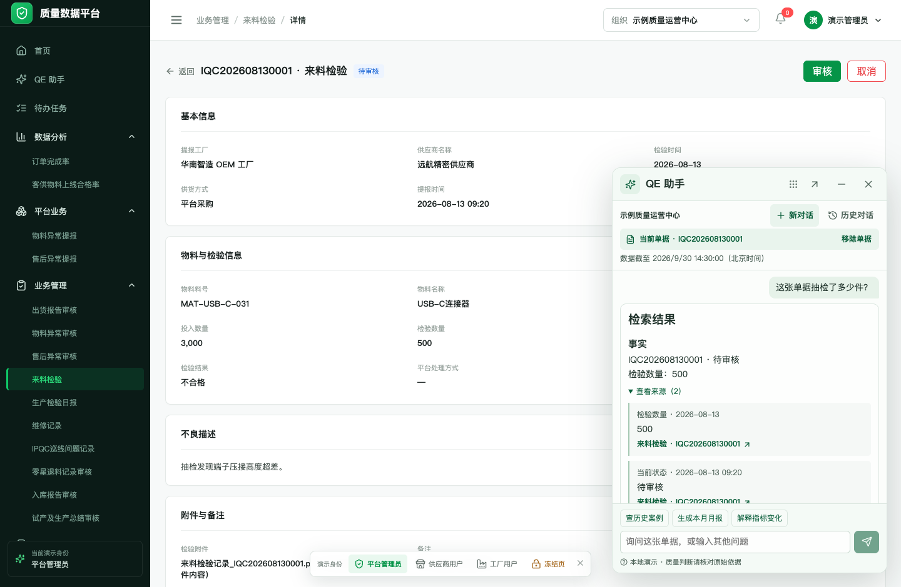
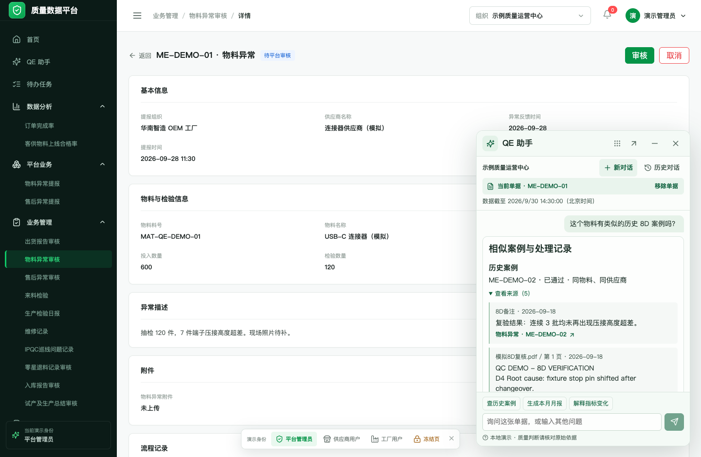
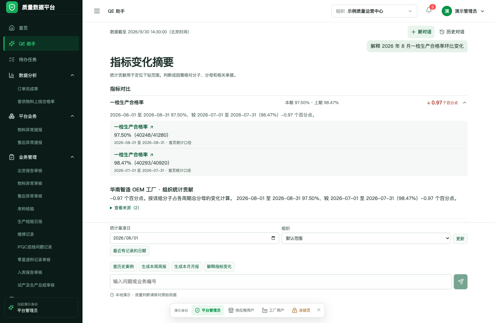
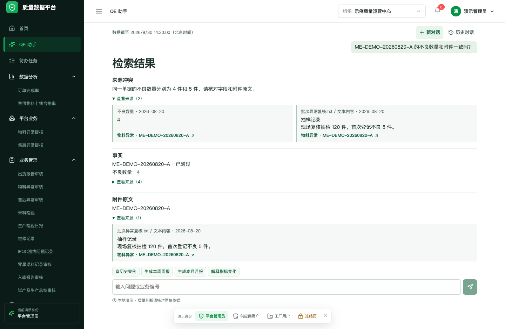
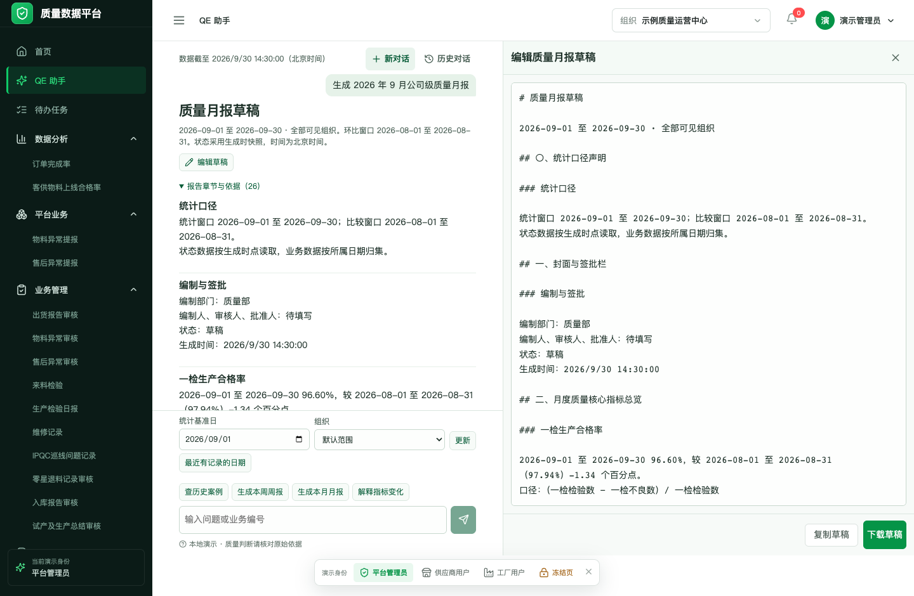

# 质量数据平台

用于演示工厂、供应商和平台侧质量管理流程的本地应用，包含业务提报、质量指标和 QE 质量副驾。检验记录与附件使用演示数据。

## QE 助手界面

以下截图来自本地演示。以「平台管理员」登录后，从左侧导航打开 QE 助手，也可以在单据详情页打开悬浮助手。

### 今日简报

集中查看待办、超期、临期、跟踪中的异常和待补资料。优先处理列表可直达原单据，指标波动可展开查看对比依据。



### 当前单据问答

在来料检验详情中打开助手，它会带入当前单据。问「这张单据抽检了多少件？」即可看到抽检数量、单据状态和可回查的字段引用。



### 历史案例检索

从物料异常单追问类似的历史 8D 案例。助手列出相似点、以往处理记录和附件页码，方便核对当时的根因与复验结果。



### 指标变化分析

指定指标和周期即可查看环比。示例中，8 月一检生产合格率较 7 月下降 0.97 个百分点。展开对比能看到两期的分子、分母及对应明细，还可按组织或物料查看统计贡献。



### 单据与附件核对

同一张异常单在字段里记了 4 件不良，附件里记了 5 件。助手并排展示两处记录，给出附件原文和单据链接，便于人工核对。



### 周报与月报草稿

指定周期和组织后，助手汇总质量指标、异常记录和参考来源。左侧可展开查看报告章节与依据，右侧可编辑 Markdown 草稿并复制或下载。截图展示的是 2026 年 9 月质量月报。



## 本地运行

使用 Node.js 24 和 pnpm 11.16.0。

```bash
pnpm install --frozen-lockfile
pnpm dev
```

打开终端显示的本地地址，在登录页选择「平台管理员」。如需体验截图中的历史案例、附件冲突和月报数据，登录后访问 `/app/platform?qeDemo=1` 载入扩展演示数据，再打开 QE 助手。

若需在本地接入模型，将 `apps/web/.env.example` 复制为 `apps/web/.env.local` 并填写配置。

运行 `pnpm test` 执行测试，运行 `pnpm build` 检查类型并构建应用。
